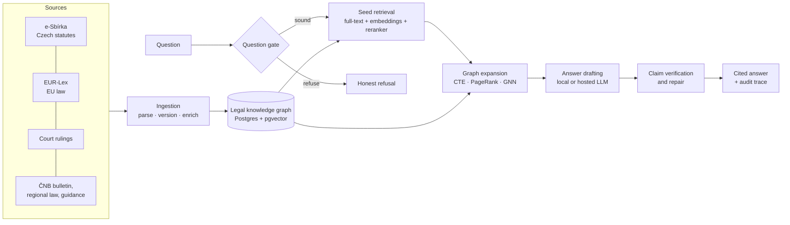

# Pythia

**A graph-based legal reasoning system for Czech and EU law.**

Ask Pythia a legal question in plain language. It finds the provisions that actually govern the situation, follows the links between them (definitions, cross-references, amendments, implementing decrees, court rulings), and drafts an answer in which every claim is tied to a specific paragraph of law. Before an answer is shown, a verification layer checks each claim against the cited text and refuses rather than guesses when the law does not support it.

The repository contains the whole product: the reasoning engine, the web application around it, and the tooling that builds and maintains the legal knowledge graph.

---

## Highlights

- **A real legal knowledge graph.** 658 source documents (249 statutes, 200 court rulings, 58 ministerial decrees, 49 regional and municipal regulations, 48 EU acts, 31 government regulations, the constitutional order and selected regulator guidance), broken down into **54,414 provisions** connected by **232,976 typed edges** across 18 relation types.
- **Law as it stood on any date.** 49,209 provision versions let every question be answered "as of" a past or future date, not only against today's text.
- **Hybrid retrieval with three graph strategies.** Czech full-text search (hunspell stemming) plus dense embeddings (bge-m3) and a cross-encoder reranker find the starting provisions. The graph is then expanded with a recursive SQL walk, Personalized PageRank, or a **custom graph neural network** trained on this corpus.
- **Answers you can audit.** Each answer carries its citations, the graph path that led to every cited provision, a trust tag (binding statute or soft law, in force or repealed), and a full audit trace.
- **Built-in protection against hallucination.** A question gate refuses questions that are off-topic, outside the corpus, or based on a false premise. Drafted answers are split into atomic claims and checked one by one by specialised verifiers (citations, facts, calculations, applicability).
- **Full-stack product.** A FastAPI backend with multi-tenant data isolation, entitlements, metering and audit logging, and a Next.js 16 / React 19 frontend that includes an interactive 3D view of the legal graph.
- **Engineered to be trusted.** More than 3,300 automated tests, CI on every push, generated governance documents for every feature flag, and reproducible model checkpoints pinned by SHA-256.

---

## How it works



1. **Ingest.** Connectors for the Czech Collection of Laws (e-Sbírka), EUR-Lex, Czech court decisions, the Czech National Bank bulletin, regional and municipal regulations, and regulator guidance download the sources and split them into provisions and clauses. Each provision keeps its full version history.
2. **Build the graph.** Cross-references are resolved, defined terms are linked to where they are used, and structural, hierarchical and temporal relations are materialised as typed, weighted edges.
3. **Retrieve.** A hybrid search picks seed provisions. A graph expansion then collects the "four corners" of the question: the definitions, exceptions, sanctions and implementing rules a lawyer would also check.
4. **Reason.** The question is decomposed, the evidence assembled, and an answer drafted by a language model: a local model through Ollama by default, with OpenAI and Anthropic as drop-in providers.
5. **Verify.** The draft is broken into claims. Every claim must be supported by the text it cites. Unsupported claims are repaired or removed, and the answer records what was verified and how.

---

## Repository layout

| Path | What lives there |
|---|---|
| [`engine/`](engine) | **Pythia engine** (Python package `pythia`): ingestion, the knowledge graph, retrieval, the GNN, answer drafting and verification, served as an HTTP sidecar |
| [`engine/pythia/ingest/`](engine/pythia/ingest) | Source connectors, parsing, versioning, enrichment and integrity checks |
| [`engine/pythia/graph/`](engine/pythia/graph) | Relation registry, graph materialisation, CTE / PageRank expansion, rank fusion, trust resolution |
| [`engine/pythia/gnn/`](engine/pythia/gnn) | The graph neural network and its checkpoint handling |
| [`engine/pythia/reasoning/`](engine/pythia/reasoning) | Question gate, intake, drafting, claim verification and repair |
| [`engine/train/`](engine/train), [`engine/eval/`](engine/eval) | GNN training pipeline, gold question sets and evaluation harnesses |
| [`app/`](app) | **Web application backend** (Python package `regsuper`): API, analysis cascade, tenancy, entitlements, billing, observability |
| [`app/frontend/`](app/frontend) | **Web interface** (Next.js 16, React 19, TanStack Query, Tailwind CSS 4) |
| [`app/migrations/`](app/migrations), [`app/deploy/`](app/deploy) | Database schema and deployment scaffolding (Docker, Caddy, systemd) |

---

## Tech stack

| Layer | Technology |
|---|---|
| Language | Python 3.12, TypeScript |
| API | FastAPI, Pydantic v2, Uvicorn |
| Data | PostgreSQL 16, pgvector, PostGIS, asyncpg, SQLAlchemy 2 |
| Retrieval | Czech hunspell full-text search, BAAI bge-m3 embeddings, bge-reranker-v2-m3, NetworkX / SciPy (PageRank) |
| Machine learning | PyTorch graph neural network (two-stage training: self-supervised, then supervised) |
| Language models | Ollama (local, default), OpenAI, Anthropic |
| Frontend | Next.js 16, React 19, TanStack Query, Tailwind CSS 4, react-force-graph-3d |
| Quality | pytest (~3,300 tests), Vitest, Ruff, ESLint, TypeScript, GitHub Actions |

---

## Quality and evaluation

- **Tests.** About 1,500 engine tests and 1,850 application tests cover the retrieval maths, the graph, the verification loop, the API contracts and the tenancy boundaries. CI runs the engine guardrails, the full application suite and the frontend checks on every push.
- **Evaluation harnesses.** Hand-labelled gold sets (layman questions, multi-hop questions, case-law questions), a retrieval evaluator, an answer evaluator with an independent fabrication check, and a paired-bootstrap comparison tool for A/B decisions.
- **Measured retrieval.** On questions held out from training, the trained GNN surfaces 56% of the relevant provisions within its top 20 results for human-written questions (n = 30) and 71% for case-law-derived questions (n = 40). Mean reciprocal rank is 0.29 and 0.56 respectively.
- **Governed feature flags.** Every behaviour change ships behind a flag that defaults to off. A generated registry ([engine](engine/docs/FLAG_GATES.md), [app](app/docs/FLAG_GATES.md)) records the gate each flag must pass before it is switched on, and a test fails if code and registry drift apart.
- **Reproducibility.** Model checkpoints are pinned by SHA-256 together with the exact command that regenerates them, and the corpus has a documented recovery path ([engine/docs/REBUILD.md](engine/docs/REBUILD.md)).

---

## Getting started

**Prerequisites:** Python 3.12, Node.js 22, Docker, and (for local answers) [Ollama](https://ollama.com) with `qwen2.5:14b`.

```bash
# 1. Database: Postgres 16 with pgvector and PostGIS
cd app && docker compose up -d && cd ..

# 2. Engine
cd engine
python3.12 -m venv .venv && .venv/bin/pip install -e '.[dev]'    # add ',gnn' for the GNN stack
.venv/bin/uvicorn pythia.service:app --port 8099                 # corpus setup: docs/REBUILD.md
cd ..

# 3. Application backend
cd app
python3.12 -m venv .venv && .venv/bin/pip install -e '.[dev]'
cp secrets.env.example secrets.env        # set PYTHIA_ENABLED=true, PYTHIA_URL=http://localhost:8099
.venv/bin/uvicorn regsuper.api.main:app --port 8002
cd ..

# 4. Frontend
cd app/frontend && npm install && npm run dev                     # http://localhost:3000
```

Run the checks:

```bash
cd engine && .venv/bin/pytest -m "not live and not flags_on"     # engine (uses the local corpus DB)
cd app && .venv/bin/pytest                                        # application
cd app/frontend && npm run lint && npx tsc --noEmit && npm test   # frontend
```

---

## Design principles

- **One door into the knowledge graph.** The engine reaches the graph only through a single port (`NexusPort`), and a test enforces that boundary, so storage and retrieval can evolve without touching reasoning code.
- **Frozen contracts.** The engine's public API (`PythiaQuery` → `PythiaAnswer`) is a versioned Pydantic model. New fields are additive and default to the previous behaviour.
- **Fail safe, never silent.** If a component degrades (the GNN checkpoint is missing, a retrieval leg errors, the model is unreachable), the system falls back to a simpler path and records it, or refuses with a reason. It does not invent an answer.
- **Default off, measured on.** New capabilities land switched off and are only enabled after they clear a named gate: a test, an A/B run on gold data, or a lawyer's review.

---

## Documentation

- [Engine overview](engine/README.md)
- [Corpus recovery and rebuild](engine/docs/REBUILD.md)
- [Question-gate acceptance criteria](engine/docs/AC_METAGATE.md)
- [Frontend](app/frontend/README.md)
- [Production deployment runbook](app/docs/deploy.md)
